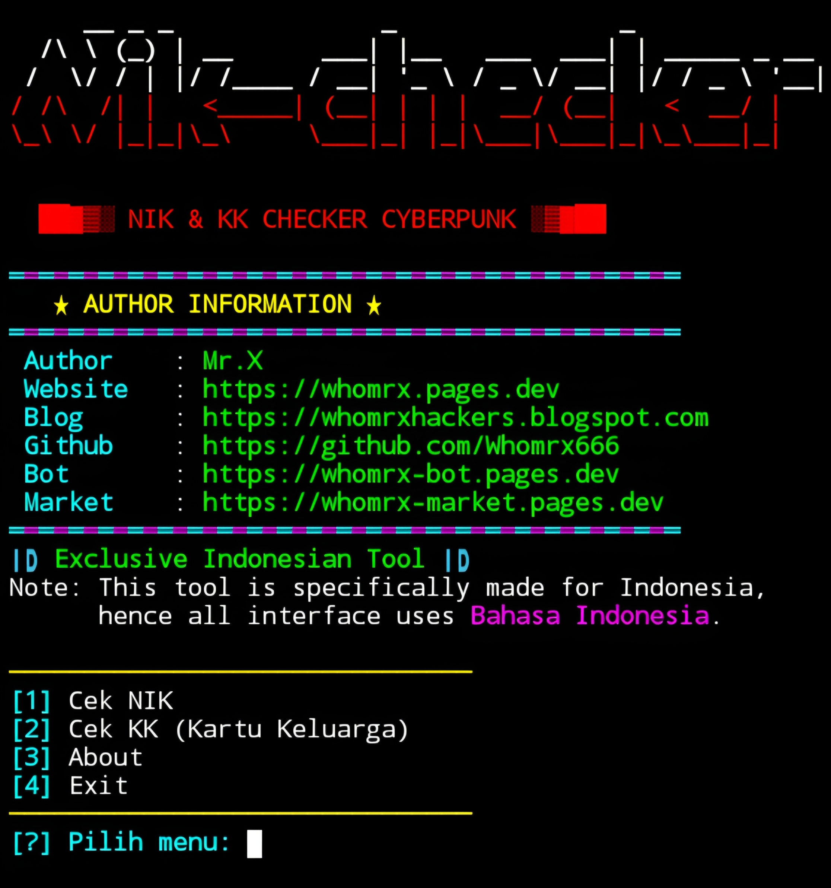

# NIK & KK Checker


<p align="center">
  <strong>Indonesian Identity Number & Family Card Decoder – Cyberpunk Neon Edition</strong><br>
  <em>"Decode the hidden data in every citizen's number." – Mr.X</em>
</p>

## Introduction
NIK & KK Checker Cyberpunk is a powerful Indonesian identity data decoder that extracts hidden information from 16-digit NIK (Nomor Induk Kependudukan) and KK (Kartu Keluarga) numbers. It reveals region codes, province, city/regency, district, birth date, gender, Javanese weton, zodiac, shio, generation, and much more. The tool includes a complete region database covering all Indonesian provinces and regencies. With its cyberpunk neon interface, red-white banner, and typing effects, it runs smoothly on **Termux (Android)**, Linux, Windows, and Kali Linux—**no root required**.

## Installation
```bash
$ pkg update -y && pkg upgrade -y
$ pkg install git python -y
$ git clone https://github.com/Whomrx666/Nik-checker.git
$ cd Nik-checker
$ python3 install.py
```

## Run manually
```bash
$ python3 nik-checker.py
```

## Features
- **NIK Decoder** – Extract 20+ attributes from a 16-digit NIK:
  - Province, City/Regency, District (from region database)
  - Birth date (DD-MM-YYYY) and long format
  - Day of birth, Javanese pasaran, weton
  - Zodiac and zodiac element
  - Shio (Chinese zodiac)
  - Gender (male/female)
  - Age in years, months, days
  - Days remaining until birthday
  - Generation (Gen Alpha, Gen Z, Millennial, etc.)
  - Day of year, week of year, leap year status
  - Serial number, formatted NIK, reversed NIK
- **KK Decoder** – Extract region info from 16-digit KK:
  - Province, City/Regency, District
  - Serial number, total digits, reversed KK
- **Complete Region Database** – Covers all 34 Indonesian provinces, 500+ regencies/cities.
- **Cyberpunk UI** – Red-white neon banner, typing effects, loading animations, progress bars.
- **Interactive Menu** – Simple option-based navigation in Bahasa Indonesia.
- **No Root Required** – Works flawlessly on Termux.
- **Educational Use** – Designed for learning how Indonesian identity numbers are structured.

## Menu Options
| #  | Option | Description |
|----|--------|-------------|
| 1  | Cek NIK | Decode a 16-digit NIK and display all extracted data |
| 2  | Cek KK | Decode a 16-digit KK and display region information |
| 3  | About | Learn about the tool and its features |
| 4  | Exit | Quit the program |

## Instructions
1. **Install** the tool using the commands above.
2. **Run** `python3 nik-checker.py` to start.
3. **Choose menu option** – Select `1` for NIK, `2` for KK, `3` for about, or `4` to exit.
4. **Enter the number** – Input a 16-digit NIK or KK when prompted.
5. **View decoded data** – The tool will display all extracted attributes in a table.
6. **Return to menu** – Press Enter after viewing results to go back.

## Observation
This tool is intended for **educational purposes only**. It does not access any government database; it only decodes the structure of the numbers based on publicly known formats. The author is not responsible for any misuse of the information provided. Always respect privacy and use this tool responsibly.

### Original Author
<a href="https://github.com/Whomrx666"></a>

### <<< If you copy, then give me the credits >>>

## CONNECT WITH ME :

[](https://whomrx.pages.dev)<br>
[](https://whomrxhackers.blogspot.com)<br>
[](https://twitter.com/whomrx666)<br>
[](https://wa.me/6285926601133?text=Halo%2C%20Mr.X)<br>
[](https://www.facebook.com/whomrx.666)<br>
[](https://t.me/Whomr_X)<br>
[](mailto:whomrx666@gmail.com)<br>
[](https://www.tiktok.com/@whomr.x)

<br>

**If you want to donate, click on the button**<br>
<a href="https://saweria.co/whomrx"></a>

---

<p align="left">
  
</p>